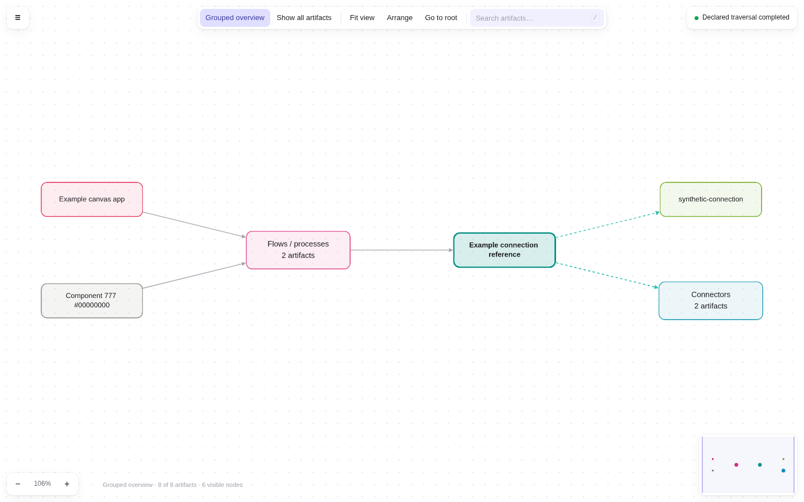

# Unverse

**Unslop your data.** Unverse is a TypeScript CLI and library for repeatable,
Dataverse diagnostics and guarded additive schema changes: identify the caller,
inspect assignments, discover tables, run OData reads, review schema plans,
find solutions, apps, flows and users, compare masked configuration, seed
development data, and transfer a verified modeled subset between Dataverse
environments or into PostgreSQL.

**Dependency graphs.** Explore declared artifact dependencies, connection
bindings, cycles, and potential impact paths. Export an offline HTML canvas,
Mermaid, or a static SVG drawn locally by [Pele](https://pele.run), without
sending environment metadata to a remote renderer.




## Install

The current version is a **local release candidate**, not a published npm
release. Obtain all four matching `0.5.0-rc.1` tarballs from the maintainer.
The paths below are placeholders for those downloaded files:

```sh
npm install --global ./unverse-core-0.5.0-rc.1.tgz ./unverse-dataverse-0.5.0-rc.1.tgz ./unverse-postgres-0.5.0-rc.1.tgz ./unverse-cli-0.5.0-rc.1.tgz
unverse --help
```

No package publication, npm scope ownership, or public download URL is implied.

## Start here

1. Run `unverse init --confirm` in your project, then
   [connect a development environment](docs/how-to-connect-an-environment.md).
2. Run `unverse env whoami --env dev --format json` with the configured credential
   variables already exported by your secret manager or shell.
3. [Discover a table](docs/how-to-discover-tables.md), then
   [repeat a read](docs/how-to-query-records.md).
4. [Find apps, flows, solutions, and users](docs/how-to-discover-resources.md)
   [list artifacts of one type](docs/how-to-list-artifacts.md), or
   [compare configuration](docs/how-to-compare-environments.md).
5. [Seed synthetic development rows](docs/how-to-seed-data.md) after reviewing
   an explicitly owned model and schema, or
   [write your own pipeline](docs/how-to-write-a-pipeline.md).
6. [Visualize dependencies](docs/how-to-explore-dependencies.md) or
   [trace potential impact](docs/how-to-assess-dependency-impact.md) before
   changing a shared artifact.

**Explicit environments.** Every environment operation requires `--env` or
`UNVERSE_ENV`; a file never picks one. The configuration is
`.unverse/config.json`, found from the current directory upward. Profiles
contain variable references, not secret values. See
[configuration](docs/design.md#6-environments-and-authentication).

**Evidence, not access claims.** Direct and team assignment sources survive
deduplication. Assignment inspection does not prove effective access. See
[role inspection](docs/how-to-list-user-roles.md).

**Automation.** `--format json` writes one versioned result to stdout. Failed expectations,
invalid input, authentication, permissions, service failures, unsupported
capabilities, and incomplete coverage have distinct exits. See
[results](docs/design.md#8-results-and-exits) and the
[command model](docs/design.md#18-command-model).

**Standards.** Name the artifact types your team cares about and the rules
each must follow in one optional `.unverse/artifacts.json`; `artifact check`
reports violations with a distinct exit. See
[checking artifacts](docs/how-to-check-artifacts.md).

**Verified subset.** [Transfer manifests](docs/how-to-export-data.md) retain
modeled IDs, relationships, decimals, and temporal semantics. PostgreSQL
imports use an owned schema and transactional checkpoint, not a merge into
existing application tables.

**Development convenience.** Search display and internal names, inspect the
authenticated caller's roles, and export [spreadsheet-safe CSV](docs/how-to-export-csv.md).
[Dataverse-to-Dataverse data plans](docs/how-to-transfer-dataverse.md) require
an explicit field-copy policy and never clear or overwrite target rows.

**Your own pipelines.** Keep data pipelines in your repository under
`.unverse/pipelines`; Unverse runs them with a read-only context and turns what
they return into a reviewed plan. A pipeline runs with your permissions and is
not sandboxed. See [write a pipeline](docs/how-to-write-a-pipeline.md).

## Interface

There is no TUI or persistent screen. Enter a command in your shell; it prints
one result and exits. Commands are `<group> <command>`: `unverse --help` lists
them by stage (observe, plan, apply) with each command's effect, and
`unverse <group> --help` or `unverse <command> --help` explains one. `Ctrl-C`
interrupts the current command. `--format human|json|csv` selects the output;
graph commands also offer `html`, `mermaid`, and `svg`.
[Terminal views](docs/screens.md) show every implemented diagnostic. Graph
commands do not start a server or add a TUI. Browser zoom and scrolling work on
the HTML file. `unverse spec` prints the whole command spec as JSON, so tools
can allowlist the `read` commands.

| Command | Purpose |
| --- | --- |
| `init` | Create `.unverse/config.json` from a template |
| `config check` | Validate one local profile |
| `env list` | List configured profile names and URLs offline |
| `env whoami` | Identify the actual caller |
| `env doctor` | Probe configuration, authentication, and WhoAmI |
| `env compare` | Compare profiles by masked settings and solutions |
| `user show` | Inspect direct and retrieved-team assignments |
| `role check` | Check an expected assignment |
| `table list` | Discover table metadata |
| `record query <table>` | Run a paginated read |
| `schema inspect` | Inspect an explicitly mapped namespace |
| `schema plan` | Review additive operations and blocked changes; `--prune` plans deletions |
| `pg export` | Export a compatible modeled dataset |
| `pg import` | Create and verify an owned PostgreSQL schema |
| `pg verify` | Compare a committed target with its manifest |
| `solution list` / `solution show <solution-id>` | Find solutions and inspect membership |
| `app list` / `flow list` | Find visible apps and cloud flows |
| `artifact types` / `artifact list <type>` | Show the built-in and declared artifact types offline; list one type as normalized items |
| `artifact check [type]` | Check declared artifact types against their naming, solution, publisher, owner and managed rules |
| `user list` | Find exact user identifiers for role investigation |
| `variable list` | Inspect masked settings |
| `access plan` | Review adding existing security roles to teams |
| `pipeline list` / `pipeline show <pipeline>` | List and describe the built-in `seed` and `transfer` pipelines and your own in `.unverse/pipelines` offline |
| `pipeline plan <pipeline> -- <flags>` | Run a pipeline and review its create-only data plan |
| `apply <plan-file>` | Apply a confirmed, fresh, environment-bound schema, data, or access plan |
| `verify <plan-file>` | Check without writing whether a plan is satisfied |
| `connector list` | Inspect visible solution-aware connector metadata |
| `connref list` / `connref show <reference-id>` | Inspect bindings without claiming health |
| `deps list` / `deps graph` / `deps impact` | Explore declared dependencies and potential impact |
| `spec` | Print the command spec as JSON |

See the generated [CLI reference](docs/cli.md) for arguments.

## What it does not do

This candidate does not provide a TUI, auditing, implicit impersonation,
effective-record-access checks, SQL, entity deletion, purge,
deduplication, Power BI inventory, reverse PostgreSQL-to-Dataverse import, or
continuous synchronization. No SLB application schemas or business pipelines
are bundled.

## Known limitations

- `env doctor` probes WhoAmI only; it does not establish other permissions.
- Retrieved teams do not establish complete transitive Entra group membership.
- Record reads are not a transactional snapshot across pages.
- Row caps report incomplete coverage instead of proving total counts.
- Metadata substring search is performed locally because the metadata API
  does not support `contains`.
- Applying a schema plan is additive, is not an atomic multi-request transaction, and
  never retries writes automatically. Inspect and re-plan after a failure.
  Required fields are application-level in Dataverse, not server-side NOT NULL
  guarantees. See [schema limits](docs/design.md#14-schema-model-and-safety).
- Transfer is a bounded, in-memory modeled subset, not a full platform
  migration. It excludes workflows, plugins, policies, files, and
  unmodeled columns. [Transfer limits](docs/design.md#15-transfer-contract-and-postgresql)
  describe checkpoint resume, decimal ranges, and explicit UTC second resolution.
  Fractional seconds are rejected rather than silently rounded. PostgreSQL
  integration is verified against version 18.6; other server versions are untested.
- Local choices and multiline text are supported. Money, floating-point, files,
  global/multiselect choices, and polymorphic lookups remain unsupported.
  External lookups are metadata-only: portable datasets must model all related
  entities instead of claiming unverified external relationship integrity.
- App/flow inventory is limited to Dataverse-visible metadata, not all maker
  portal resources. `--source platform` reads the Power Platform API instead;
  a service principal needs Power Platform admin registration and an RBAC
  role, flow APIs work for service principals only where no license is
  required, and that source was read in the documentation, not observed
  running ([design §20](docs/design.md#20-power-platform-api-source)). Solution-version comparison is not a dependency diff.
  Secret or ambiguous variable values prevent a complete equality claim.
- Dataverse seed/transfer uses bounded atomic changesets (1000 operations,
  4 MB) with re-plan-and-verify resume, not per-row checkpoints. Distinct real
  source/target environment transfer is not yet observed; two-environment
  behaviour is fixture-backed. IDs are preserved and can identify people even
  when selected fields are replaced.
- Dependency graphs are bounded observations of platform-declared dependencies,
  not runtime traces, complete external-system graphs, or safe-delete checks.
  Unknown labels, failed reads, and unexplored frontiers remain visible. Connector
  and reference inventory does not test credentials, connection health, DLP, or
  effective access; broader connection management is not implemented.
- `.env` is not automatically loaded by the CLI. Export referenced variables
  before invoking it. Credentials are for an application user, not a Code App
  user session.

Contributors: start with [the design and development contract](docs/design.md).

## Requirements

Node.js 24.22.0 or a later Node 24 release, npm, HTTPS access to Microsoft
Entra ID and the selected Dataverse environment, and an application user with
the permissions required by each command. Transfer import also requires a
PostgreSQL database role permitted to create a dedicated schema.

## License

[MIT](LICENSE). The Python reference implementation was inspected for
behaviour; its source was not copied into Unverse.
