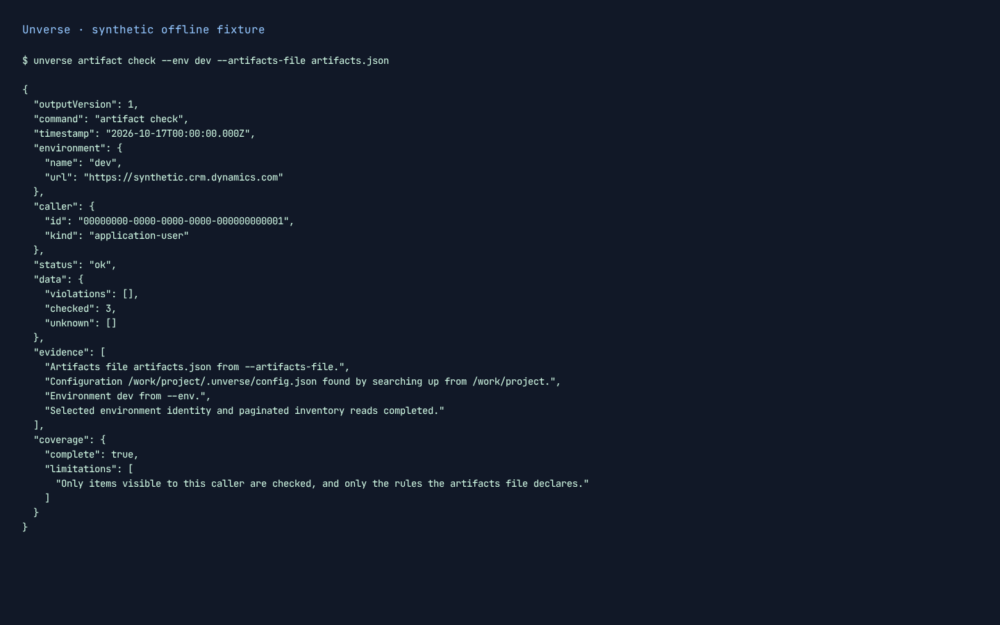

# Check artifacts against your standards

**The question:** How do I name the artifact types my team cares about, state
the rules each must follow, and have CI fail when an environment breaks them?

This page is enough on its own for declaring types and rules. It needs
[a connected environment](how-to-connect-an-environment.md) for steps 3 and 4;
steps 1 and 2 work offline. The file is optional: without it, `artifact check`
succeeds and says no rules are declared.

## Before you start

- The application user needs read permission for the types you check, and for
  solutions and solution components when a rule uses `solution` or
  `publisher`.
- `<type>` below is a placeholder for one of your declared type names.
- The complete rule grammar is in
  [design §19](design.md#19-artifact-catalog). This page shows it in use.

## Steps

1. Write `.unverse/artifacts.json` next to `.unverse/config.json`, or pass
   `--artifacts-file <path>`. Unverse finds the file from the current directory
   upward. The synthetic example in [`examples/artifacts.json`](examples/artifacts.json):

   ```json
   {
     "artifactsVersion": 1,
     "types": {
       "code-app": { "from": "canvas-app", "where": { "kind": "code-app" } },
       "fixture-table": { "from": "table", "where": { "name": "tx_*" } }
     },
     "rules": {
       "code-app": {
         "name": "fixture_{app}",
         "solution": "required",
         "publisher": ["fx"]
       },
       "fixture-table": {
         "name": "tx_{entity:lower}",
         "solution": ["CommunityFixture"]
       }
     }
   }
   ```

   `types` maps your names to a built-in type (`from`) and an optional filter
   (`where`). A `where` value is a string with `*` globs, a list of strings
   (any of), or a boolean. `rules` is keyed by your type names. The rules:

   | Rule | Value | Passes when |
   | --- | --- | --- |
   | `name`, `displayName` | pattern | the value matches the pattern |
   | `solution` | `"required"` | the item is in an unmanaged solution other than `Default`, `Active` or `Basic` |
   | `solution` | `"forbidden"` | the item is in no such solution |
   | `solution` | list of unique names | the item is in one of the named solutions |
   | `publisher` | list of prefixes | the item is in such a solution and all those solutions have a listed publisher prefix |
   | `owner` | list of IDs | the owner is one of them |
   | `managed` | `true` or `false` | the managed state equals it |

   A pattern is literal text plus placeholders: `{label}` (one or more
   characters), `{label:lower}`, `{label:upper}`, `{label:digits}` and
   `{label:digits:N}` (exactly N digits). The whole value must match, and
   literal text is case-sensitive. Reusing a label in one pattern requires
   the same text.

2. See the declared types without contacting Dataverse:

   ```sh
   unverse artifact types --artifacts-file artifacts.json
   ```

   The result lists the built-in catalog and `userTypes`. A mistake in the
   file stops here with exit 2. A field the built-in type does not provide:

   ```text
   Type x where.kind: table does not provide kind; allowed: name, displayName, solution, publisher, id.
   ```

   A malformed placeholder:

   ```text
   Rule x.name has a malformed placeholder in pattern {a; use {label}, {label:lower}, {label:upper}, {label:digits} or {label:digits:N}.
   ```

3. Check every declared type, or one:

   ```sh
   unverse artifact check --env dev --artifacts-file artifacts.json
   unverse artifact check <type> --env dev
   ```

   Against the synthetic fixture, all rules hold and the exit is 0:

   

   Unverse reads each built-in type once and, because the example uses
   `solution` and `publisher`, reads solution membership once for all items
   (one `solutions` and one `solutioncomponents` read, not one request per
   item).

4. Read a failing result. With the rule `"name": "kpo_{app}"` on `code-app`,
   `"name": "tx_{entity:upper}"` on `fixture-table`, and
   `{ "name": "fixture_{flow}", "managed": false }` on a declared
   `fixture-flow` type (`"from": "cloud-flow"`), the synthetic fixture
   produced (shortened):

   ```json
   {
     "status": "failed",
     "data": {
       "violations": [
         {
           "type": "code-app",
           "rule": "name",
           "item": { "id": "00000000-0000-0000-0000-000000000014", "name": "fixture_canvas" },
           "expected": "kpo_{app}",
           "observed": "fixture_canvas"
         }
       ],
       "checked": 4,
       "unknown": [
         {
           "type": "fixture-flow",
           "rule": "managed",
           "item": { "id": "00000000-0000-0000-0000-000000000016", "name": "fixture_flow" },
           "field": "managed",
           "reason": "The item has no managed."
         }
       ]
     }
   }
   ```

   (The two `fixture-table` violations are omitted here.) `expected` is the
   rule value and `observed` is what the environment returned. An item that
   lacks a field a rule needs is listed under `unknown`, never passed.

   | Exit | Meaning |
   | --- | --- |
   | 0 | Every selected item satisfies every rule. |
   | 1 | At least one violation. |
   | 7 | No violation, but a rule or filter could not be evaluated for some item. The fixture flow has no managed state, so checking only `fixture-flow` produced this. |
   | 2 | The file or the type argument is invalid; nothing was requested. |

## What can go wrong

- `artifact check` of a built-in type name, or of a type that is not declared,
  exits 2: `Unknown declared type <name>; declared types: ...`.
- A rule that always exits 7: the platform did not return that field. The
  catalog lists the fields each type provides; a row can lack `ismanaged`, and
  tables and model-driven apps never provide `managed`. Drop the rule or
  accept the exit.
- `solution: "required"` counts only unmanaged solutions. A managed item that
  was imported in a managed solution fails it.
- Solution component types of `table` (1), `security-role` (20), `cloud-flow`
  (29), `model-driven-app` (80), `canvas-app` (300) and `environment-variable`
  (380) are mapped from the documentation and were not observed against a live
  environment. `connection-reference`, `connector` and `solution` cannot use
  `solution` or `publisher`.

## Next

[List artifacts](how-to-list-artifacts.md) of a declared type, or
[trace dependencies](how-to-explore-dependencies.md) before fixing a violation.
