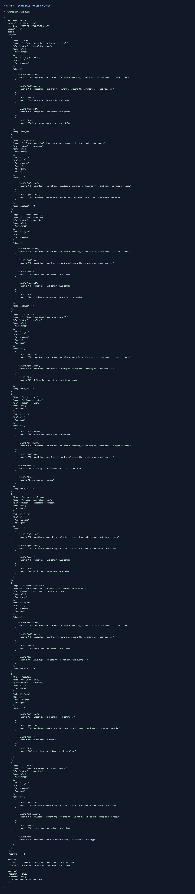

# List artifacts of one type

**The question:** How do I list every app, flow, role, variable, table, or
other artifact in an environment in one uniform shape, including the types my
team named?

This page needs [a connected environment](how-to-connect-an-environment.md)
for step 2; step 1 works offline and is enough to see what is available.

## Before you start

The application user needs read permission for the type you list. The fields
a type provides are fixed by the catalog ([design §19](design.md#19-artifact-catalog)).
A field the platform does not return for an item is absent, not defaulted.

## Steps

1. See the built-in types, their platform names, sources, and fields. No
   `--env` is needed and Dataverse is not contacted:

   ```sh
   unverse artifact types
   ```

   The output lists nine types, for example `canvas-app` with platform name
   `canvasapps`, source `dataverse`, fields `displayName`, `owner`, `managed`,
   and `kind`, and the fields it cannot provide with a reason for each.
   

2. List one type. `<type>` is a placeholder for a name from step 1:

   ```sh
   unverse artifact list canvas-app --env dev
   ```

   The synthetic fixture returned one item:

   ```json
   {
     "type": "canvas-app",
     "id": "00000000-0000-0000-0000-000000000014",
     "name": "fixture_canvas",
     "displayName": "Synthetic Canvas App",
     "owner": "00000000-0000-0000-0000-000000000001",
     "managed": false,
     "kind": "code-app",
     "source": "dataverse"
   }
   ```

   

   `kind` separates classic canvas apps, component libraries, custom pages,
   unified apps, code apps, and mobile apps. A value Unverse does not
   recognize is `unknown`.

3. Cap or export the list:

   ```sh
   unverse artifact list canvas-app --env dev --limit 50 --format csv
   ```

   If more items exist than the cap, the result is `inconclusive` with
   incomplete coverage and the command exits 7. See
   [CSV output](how-to-export-csv.md) for the spreadsheet rules.

4. Optional: list a type your team declared. A declared type is a built-in
   type plus a filter, written in `.unverse/artifacts.json`
   ([how to declare and check them](how-to-check-artifacts.md)). With the
   example file `docs/examples/artifacts.json` the declared `code-app` type
   keeps the canvas apps whose `kind` is `code-app`:

   ```sh
   unverse artifact list code-app --env dev --artifacts-file artifacts.json
   ```

   `artifact types` also lists the declared types, offline. When the filter
   or a rule needs solutions or publishers, the items carry `solutions`, read
   once for all items:

   ```json
   {
     "type": "canvas-app",
     "id": "00000000-0000-0000-0000-000000000014",
     "name": "fixture_canvas",
     "kind": "code-app",
     "solutions": [
       { "uniqueName": "CommunityFixture", "managed": false, "publisher": "fx" }
     ]
   }
   ```

   (Other fields omitted here.) An item that lacks a field the filter needs is
   left out and listed under `unknown`; the result is then `inconclusive` and
   the command exits 7.

## What can go wrong

An unknown type exits 2 before any connection is made:

```text
Unknown type nonsense; choose one of table, canvas-app, model-driven-app, cloud-flow, security-role, connection-reference, environment-variable, solution, connector.
```

The list ends with the declared types when an artifacts file is found. A
declaration error, such as a field the built-in type does not provide, also
exits 2 before any connection is made.

A denied read fails the command instead of returning an empty list. Built-in
types never carry solution membership or publisher; only a declared type that
needs them reads them. See [design §19](design.md#19-artifact-catalog). Environment variable
values are never read.

## Next

[Check artifacts against rules](how-to-check-artifacts.md),
[find solutions and their components](how-to-discover-resources.md) or
[trace dependencies](how-to-explore-dependencies.md).
