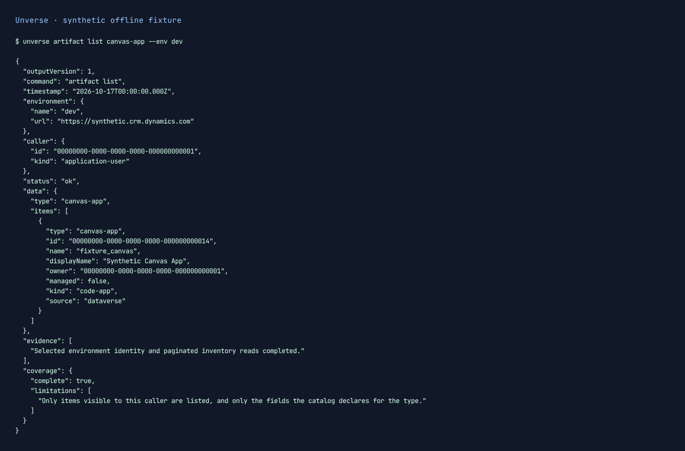

# List artifacts of one type

**The question:** How do I list every app, flow, role, variable, or other
built-in artifact in an environment in one uniform shape?

This page needs [a connected environment](how-to-connect-an-environment.md)
for step 2; step 1 works offline and is enough to see what is available.

## Before you start

The application user needs read permission for the type you list. The fields
a type provides are fixed by the catalog ([design §19](design.md#19-artifact-catalog)).
A field the platform does not return for an item is absent, not defaulted.

## Steps

1. See the built-in types, their platform names, sources, and fields. No
   `--env` is needed and Dataverse is not contacted:

   ```sh
   unverse artifact types
   ```

   The output lists nine types, for example `canvas-app` with platform name
   `canvasapps`, source `dataverse`, fields `displayName`, `owner`, `managed`,
   and `kind`, and the fields it cannot provide with a reason for each.
   

2. List one type. `<type>` is a placeholder for a name from step 1:

   ```sh
   unverse artifact list canvas-app --env dev
   ```

   The synthetic fixture returned one item:

   ```json
   {
     "type": "canvas-app",
     "id": "00000000-0000-0000-0000-000000000014",
     "name": "fixture_canvas",
     "displayName": "Synthetic Canvas App",
     "owner": "00000000-0000-0000-0000-000000000001",
     "managed": false,
     "kind": "code-app",
     "source": "dataverse"
   }
   ```

   

   `kind` separates classic canvas apps, component libraries, custom pages,
   unified apps, code apps, and mobile apps. A value Unverse does not
   recognize is `unknown`.

3. Cap or export the list:

   ```sh
   unverse artifact list canvas-app --env dev --limit 50 --format csv
   ```

   If more items exist than the cap, the result is `inconclusive` with
   incomplete coverage and the command exits 7. See
   [CSV output](how-to-export-csv.md) for the spreadsheet rules.

## What can go wrong

An unknown type exits 2 before any connection is made:

```text
Unknown type nonsense; choose one of table, canvas-app, model-driven-app, cloud-flow, security-role, connection-reference, environment-variable, solution, connector.
```

A denied read fails the command instead of returning an empty list. Solution
membership and publisher are not provided for any type; see
[design §19](design.md#19-artifact-catalog) for why. Environment variable
values are never read.

## Next

[Find solutions and their components](how-to-discover-resources.md) or
[trace dependencies](how-to-explore-dependencies.md).
